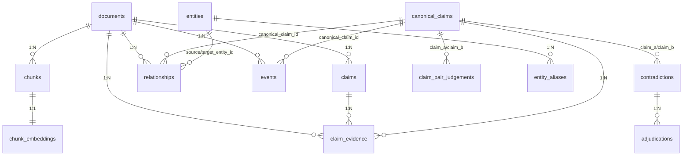

# 数据模型与表结构

> 状态：✅ 与实现同步（2026-11-25，javis `9fca6c0` + pgvector）
> 代码来源：`softwiki/source_store/models.py`；运行库实测：`softwiki_armkb`
> 相关文档：[存储与向量后端](../03-operations/storage.md) ｜ [技术选择总表](../01-architecture/technical-choices.md) ｜ [知识系统原则](knowledge-system-philosophy.md)

---

## 0. 数据库拓扑

| 库 | 内容 | 位置 |
|---|---|---|
| **KB 库**（每知识库一个 database） | 语料、claim、图、时间线、wiki 状态/任务、向量 | PG：`softwiki_<kb>`；SQLite 回退：`<workspace>/.softwiki/processed.db` |
| **身份库**（实例级） | `users`、`workspace_members` | `SOFTWIKI_AUTH_DB`；默认 `<WORKSPACES_ROOT>/.softwiki-auth.db`（SQLite），auth 关闭时不创建 |
| **审计** | 非表：JSONL 追加文件 | `<workspaces root>/.softwiki-audit/audit.log` |
| LightRAG | 未启用/未安装 | — |

- 连接串优先级（`softwiki/config.py`）：`DATABASE_URL_TEMPLATE`（按 workspace 派生库名）> `DATABASE_URL` > SQLite 回退。
- 表结构由 `Base.metadata.create_all()` + `init_tables()` 里的幂等 `ALTER TABLE ADD COLUMN` / `CREATE INDEX IF NOT EXISTS` 维护，**没有 Alembic**。
- 删除策略：文档删除级联删除 chunk/claim/relationship/event/evidence/embedding；实体与 canonical claim 不随单篇文档删除（可能被其他文档引用）。



---

## 1. 语料层

### 1.1 `sources` — 来源配置

不是外键表，文档通过 `documents.source_name` 软关联。

| 字段 | 类型 | 约束 | 含义 |
|---|---|---|---|
| `id` | VARCHAR(100) | PK | 来源标识 |
| `name` | VARCHAR(200) | NOT NULL | 来源名称（与文档软关联） |
| `type` | VARCHAR(50) | | `official` / `news` / `academic` / `manual` … |
| `url` | VARCHAR(500) | | 站点或入口 |
| `trust_level` | VARCHAR(50) | | `high` / `medium` / `low` |
| `source_country` | VARCHAR(100) | | 来源国家/地区 |
| `language` | VARCHAR(10) | | 语言码 |

### 1.2 `documents` — 文档（语料的唯一入口）

| 字段 | 类型 | 约束 | 含义 |
|---|---|---|---|
| `id` | INTEGER | PK | 文档 ID |
| `title` | VARCHAR(500) | NOT NULL | 标题 |
| `url` | VARCHAR(1000) | | 原文地址（版本判定依据之一） |
| `source_name` / `source_type` / `source_country` | VARCHAR | | 来源信息 |
| `published_at` | TIMESTAMP | | 原文发布时间（claim 时效/事件排序用） |
| `collected_at` | TIMESTAMP | 默认 now | 入库时间 |
| `language` / `author` | VARCHAR | | 元数据 |
| `raw_text` | TEXT | NOT NULL | 原始正文 |
| `cleaned_text` | TEXT | NOT NULL | 清洗后正文（**切块与抽取都用它**） |
| `hash` | VARCHAR(64) | UNIQUE, NOT NULL | 内容哈希（**幂等去重键**） |
| `trust_level` | VARCHAR(50) | | 继承来源可信度 |
| `topics` | VARCHAR(500) | | 主题标签 |
| `status` | VARCHAR(50) | 默认 `completed` | `pending` / `extracting` / `completed` / `failed` |
| `family_id` | VARCHAR(200) | INDEX | 文档家族（同一来源/主题的版本链） |
| `revision` | VARCHAR(80) | | 版本号/日期 |
| `supersedes_document_id` | INTEGER | FK → documents.id, SET NULL | 被本版本取代的旧文档 |

**不变量**

- `hash` 唯一：重复入库直接命中，不重复抽取。
- 同 `family_id` 的新 `revision` 会把旧版本 claim 标记为 superseded（见 §7 生命周期）。

### 1.3 `chunks` — 检索/引用单元

| 字段 | 类型 | 约束 | 含义 |
|---|---|---|---|
| `id` | INTEGER | PK | chunk ID（向量表外键） |
| `document_id` | INTEGER | FK → documents.id, CASCADE, NOT NULL | 所属文档 |
| `chunk_index` | INTEGER | NOT NULL | 文档内顺序（0 起） |
| `text` | TEXT | NOT NULL | 文本 |
| `title` / `section` | VARCHAR | | 标题/小节 |
| `published_at` | TIMESTAMP | | 冗余的文档时间（检索过滤用） |
| `page_start` / `page_end` | INTEGER | | PDF 页码范围（引用展示） |
| `char_start` / `char_end` | INTEGER | | 文档内字符偏移（精确定位） |

**不变量**：`(document_id, chunk_index)` 逻辑唯一；页码对 PDF 有意义，markdown 来源为 NULL。

---

## 2. 知识层（Claim 为事实源）

### 2.1 `claims` — 原始抽取事实

| 字段 | 类型 | 约束 | 含义 |
|---|---|---|---|
| `id` | VARCHAR(100) | PK | UUID/哈希字符串（跨系统引用） |
| `document_id` | INTEGER | FK → documents.id, CASCADE | 出处 |
| `text` | TEXT | NOT NULL | 事实原文 |
| `actor` | VARCHAR(100) | NOT NULL | 主体（谁） |
| `topic` | VARCHAR(100) | NOT NULL | 主题 |
| `stance` | VARCHAR(50) | NOT NULL | 立场/倾向 |
| `confidence` | DOUBLE | NOT NULL | 抽取置信度 |
| `published_at` | TIMESTAMP | | 事实时间 |
| `canonical_id` | VARCHAR(100) | INDEX | 归属的 `canonical_claims.id` |
| `canonical_key` | VARCHAR(64) | INDEX | 决定归属的确定性 key |
| `status` | VARCHAR(20) | 默认 `active` | canonicalize 后为 **`merged`**（已被聚合） |
| `valid_from` / `valid_to` | TIMESTAMP | | 版本有效期 |
| `value_normalized` | VARCHAR(200) | | 抽出的数值/十六进制值（冲突检测用） |
| `subject` / `predicate` / `object` | VARCHAR | | 结构化三元组（按需填充） |
| `qualifiers` | TEXT | | 结构化的限定条件（JSON/文本） |
| `structure_hash` | VARCHAR(64) | INDEX | 三元组哈希（同结构判断） |

### 2.2 `canonical_claims` — 去重后的事实（回答以此为权威）

| 字段 | 类型 | 约束 | 含义 |
|---|---|---|---|
| `id` | VARCHAR(100) | PK | `cc_` + key 前缀 |
| `canonical_key` | VARCHAR(64) | UNIQUE, NOT NULL | `sha256(规范化 text+actor+topic+stance)` |
| `text` / `actor` / `topic` / `stance` | | NOT NULL | 聚合后的代表值 |
| `confidence` | DOUBLE | NOT NULL | 聚合置信度 |
| `status` | VARCHAR(20) | 默认 `active` | `active` / `disputed` / `superseded` / `retracted` / `error` |
| `valid_from` / `valid_to` | TIMESTAMP | | 事实有效期 |
| `supersedes_claim_id` | VARCHAR(100) | | 被取代的 canonical claim |
| `primary_document_id` | INTEGER | FK → documents.id, SET NULL | 代表性证据文档 |
| `primary_page_start` / `primary_page_end` | INTEGER | | 代表证据页码 |
| `value_normalized` | VARCHAR(200) | | 数值归一（冲突比较） |
| `evidence_count` | INTEGER | | 支撑该事实的 evidence 条数 |
| `subject` / `predicate` / `object` / `qualifiers` / `structure_hash` | | | 结构化字段 |
| `created_at` / `updated_at` | TIMESTAMP | | |

**状态语义**：只有 `active` / `disputed` 参与回答与图投影；`error` 表示抽取/人工判定为错误，不参与。

### 2.3 `claim_evidence` — 证据链（claim → 原文引用）

| 字段 | 类型 | 约束 | 含义 |
|---|---|---|---|
| `id` | INTEGER | PK | |
| `claim_id` | VARCHAR(100) | FK → claims.id, CASCADE, NOT NULL | 原始 claim |
| `canonical_id` | VARCHAR(100) | FK → canonical_claims.id, CASCADE | 聚合到的 canonical claim |
| `document_id` | INTEGER | FK → documents.id, CASCADE | 证据文档 |
| `page_start` / `page_end` | INTEGER | | 页码 |
| `char_start` / `char_end` | INTEGER | | 字符范围 |
| `quote` | TEXT | | 证据原文片段 |
| `quote_hash` | VARCHAR(64) | | 去重键（与 claim_id 组合唯一） |
| `source_name` / `source_revision` / `trust_level` | VARCHAR | | 溯源快照 |
| `published_at` | TIMESTAMP | | |
| `created_at` | TIMESTAMP | | |

**唯一约束**：`(claim_id, quote_hash)` —— 同一 claim 的同一段引用只存一次。

### 2.4 `contradictions` — 冲突对

| 字段 | 类型 | 约束 | 含义 |
|---|---|---|---|
| `id` | INTEGER | PK | |
| `claim_a_id` / `claim_b_id` | VARCHAR(100) | FK → canonical_claims.id, CASCADE | 冲突双方 |
| `type` | VARCHAR(30) | NOT NULL | `source_conflict` / `temporal_conflict` / `value_conflict` … |
| `severity` | VARCHAR(20) | NOT NULL | `high` / `medium` / `low` |
| `status` | VARCHAR(30) | NOT NULL | `open` / `needs_evidence` / `resolved` / `ignored` |
| `auto_resolved` | BOOLEAN | NOT NULL | 是否规则自动解决 |
| `resolution` / `resolved_by` / `resolved_at` | | | 裁定结果与责任人 |
| `created_at` / `updated_at` | TIMESTAMP | | |

**唯一约束**：`(claim_a_id, claim_b_id, type)`。

### 2.5 `adjudications` — 人工裁定审计

| 字段 | 类型 | 含义 |
|---|---|---|
| `id` | INTEGER PK | |
| `contradiction_id` | INTEGER FK → contradictions.id, CASCADE | 被裁定的冲突 |
| `action` | VARCHAR(40) | `accept_a` / `accept_b` / `keep_both` / `mark_error_a` / `mark_error_b` / `needs_evidence` / `reopen` |
| `before_json` / `after_json` | TEXT | 裁定前后状态快照 |
| `actor` | VARCHAR(80) | 操作人 |
| `reason` | TEXT | 理由 |
| `created_at` | TIMESTAMP | |

### 2.6 `claim_pair_judgements` — NLI/LLM 冲突判定缓存

| 字段 | 类型 | 含义 |
|---|---|---|
| `id` | INTEGER PK | |
| `claim_a_id` / `claim_b_id` | VARCHAR(100) FK → canonical_claims | 被判定的一对 |
| `model` | VARCHAR(120) | 使用的模型 |
| `verdict` | VARCHAR(30) | `contradiction` / `entailment` / `unknown` |
| `reason` | TEXT | 判定理由 |
| `severity` | VARCHAR(20) | |
| `created_at` | TIMESTAMP | |

**唯一约束**：`(claim_a_id, claim_b_id, model)` —— 同一对同一模型只判一次。

---

## 3. 图与时间线

### 3.1 `entities` — 实体节点

| 字段 | 类型 | 约束 | 含义 |
|---|---|---|---|
| `id` | INTEGER | PK | |
| `name` | VARCHAR(150) | UNIQUE, NOT NULL | 展示名（canonical） |
| `type` | VARCHAR(100) | | `product` / `ip_block` / `architecture` / `protocol` / `feature` / `register` / `component` / `standard` / `organization` / `concept` / `other`（历史数据还有 project/location/person/country） |
| `description` | TEXT | | 描述 |
| `normalized_name` | VARCHAR(200) | INDEX | 归一化匹配键（NFKC + 去标点 + 去公司后缀） |
| `aliases` | TEXT | | 抽取时被告知的别名 JSON 数组 |
| `merged_into` | INTEGER | INDEX | 被合并到哪个实体（NULL = 仍是 canonical） |

**不变量**：`merged_into IS NULL` 的实体才参与检索/展示；被合并实体不删除，保证可追溯。

### 3.2 `entity_aliases` — 别名表

| 字段 | 类型 | 约束 | 含义 |
|---|---|---|---|
| `id` | INTEGER | PK | |
| `entity_id` | INTEGER | FK → entities.id, CASCADE, INDEX | 归属实体 |
| `alias` | VARCHAR(200) | NOT NULL | 别名原文（如 `MVE`） |
| `normalized` | VARCHAR(200) | NOT NULL, INDEX | 归一化别名 |

**唯一约束**：`(normalized, entity_id)`。

### 3.3 `relationships` — 图边（同时是投影）

| 字段 | 类型 | 约束 | 含义 |
|---|---|---|---|
| `id` | INTEGER | PK | |
| `source_name` / `target_name` | VARCHAR(150) | NOT NULL | 端点名（归一后被改写为 canonical 名） |
| `source_entity_id` / `target_entity_id` | INTEGER | INDEX | 归一后的实体 ID（遍历优先用它） |
| `relation_type` | VARCHAR(100) | NOT NULL | 受控关系词（`supports` / `part_of` / `implements` …） |
| `description` | TEXT | | 关系描述/证据短语 |
| `document_id` | INTEGER | FK → documents.id, CASCADE | 出处 |
| `confidence` | DOUBLE | 默认 1.0 | 抽取置信度 |
| `published_at` | TIMESTAMP | | |
| `canonical_claim_id` | VARCHAR(100) | INDEX | 投影到的事实（回答引用） |
| `status` | VARCHAR(20) | 默认 `active`, INDEX | `active` / `disputed` / `superseded` |
| `valid_from` / `valid_to` | TIMESTAMP | | |
| `weight` | DOUBLE | 默认 1.0 | 同一 `(source,target,type)` 出现的**不同文档数** |
| `evidence_count` | INTEGER | 默认 1 | 同一三元组的行数 |

**不变量**：保留每篇文档的行（引用可追溯）；用 `weight` 表达跨文档强度，而不是删行合并。

### 3.4 `events` — 时间线

| 字段 | 类型 | 约束 | 含义 |
|---|---|---|---|
| `id` | INTEGER | PK | |
| `title` | VARCHAR(250) | NOT NULL | 事件标题 |
| `description` | TEXT | | 描述 |
| `event_date` | TIMESTAMP | NOT NULL | 发生时间（排序键） |
| `topic` | VARCHAR(100) | | 主题 |
| `document_id` | INTEGER | FK → documents.id, CASCADE | 出处 |
| `confidence` | DOUBLE | 默认 1.0 | |
| `canonical_claim_id` | VARCHAR(100) | INDEX | 投影到的事实 |
| `status` | VARCHAR(20) | 默认 `active`, INDEX | 与 claim 状态同步 |

---

## 4. Wiki 层

### 4.1 `wiki_artifact_states` — topic 页状态

| 字段 | 类型 | 约束 | 含义 |
|---|---|---|---|
| `id` | INTEGER | PK | |
| `topic` | VARCHAR(120) | UNIQUE, INDEX | 策展主题 ID |
| `prompt_version` | VARCHAR(120) | | 生成时使用的提示词版本/hash |
| `model` | VARCHAR(120) | | 模型 |
| `claim_set_hash` | VARCHAR(64) | | 当时 claim 集合的哈希（判断内容是否过期） |
| `status_counts_json` | TEXT | | active/disputed 等计数快照 |
| `built_at` | TIMESTAMP | | 最近生成时间 |
| `stale_at` | TIMESTAMP | | 非空 = 已过期，回答/展示时跳过 |
| `last_used_at` | TIMESTAMP | | |

> 注意：**subject 页（一实体一页）不写这张表**，所以 subject 页目前没有 stale 标记；这是已知欠账。

### 4.2 `wiki_artifact_versions` — 页面历史

| 字段 | 类型 | 含义 |
|---|---|---|
| `id` | INTEGER PK | |
| `topic` | VARCHAR(120), INDEX | 主题（或 subject） |
| `content` | TEXT | 页面全文 |
| `content_hash` | VARCHAR(64), INDEX | 内容哈希 |
| `claim_set_hash` | VARCHAR(64) | 生成时的 claim 快照 |
| `prompt_version` / `model` | VARCHAR | |
| `status_counts_json` | TEXT | |
| `created_at` | TIMESTAMP | |

### 4.3 `wiki_rebuild_tasks` — 重建队列（durable）

| 字段 | 类型 | 约束 | 含义 |
|---|---|---|---|
| `id` | INTEGER | PK | |
| `topic` | VARCHAR(120) | INDEX | 主题或 subject 名 |
| `kind` | VARCHAR(20) | 默认 `topic`, INDEX | `topic` / `subject` |
| `reason` | VARCHAR(200) | | 入队原因（claim 变化/裁定/手工） |
| `status` | VARCHAR(20) | NOT NULL, INDEX | `pending` / `running` / `done` / `failed` |
| `attempts` / `max_attempts` | INTEGER | | 重试控制 |
| `error` | TEXT | | 最后一次错误 |
| `created_at` / `started_at` / `finished_at` / `updated_at` | TIMESTAMP | | |

**不变量**：同 `(topic, kind)` 只允许一个 `pending/running` 任务。

### 4.4 `wiki_action_plans` — agent 提议、人工批准

| 字段 | 类型 | 含义 |
|---|---|---|
| `id` | INTEGER PK | |
| `kb` | VARCHAR(120), INDEX | 所属知识库 |
| `kind` | VARCHAR(40) | `ignore_subjects` / `delete_pages` / … |
| `payload` | TEXT | JSON 参数 |
| `status` | VARCHAR(20), INDEX | `pending` / `approved` / `rejected` / `applied` / `failed` |
| `proposed_by` / `approved_by` | VARCHAR(200) | |
| `reason` / `result` | TEXT | |
| `created_at` / `decided_at` / `applied_at` | TIMESTAMP | |

---

## 5. 身份层（独立 auth 库）

### 5.1 `users`

| 字段 | 类型 | 约束 | 含义 |
|---|---|---|---|
| `id` | INTEGER | PK | |
| `username` | VARCHAR(80) | UNIQUE, NOT NULL | 登录名 |
| `password_hash` | VARCHAR(255) | NOT NULL | scrypt（独立盐） |
| `role` | VARCHAR(20) | NOT NULL | `wiki-study` / `wiki-work` / `wiki-manage` / `wiki-admin` |
| `active_workspace` | VARCHAR(120) | | 最近选择的 KB |
| `created_at` | TIMESTAMP | | |

### 5.2 `workspace_members`

| 字段 | 类型 | 约束 | 含义 |
|---|---|---|---|
| `id` | INTEGER | PK | |
| `username` | VARCHAR(80) | NOT NULL | 用户 |
| `workspace` | VARCHAR(120) | NOT NULL | KB 名 |
| `role` | VARCHAR(20) | NOT NULL | 在该 KB 的角色 |

**唯一约束**：`(username, workspace)`。

> 这两张表在 KB 库里也存在（ORM 统一创建），但**实际数据在 auth 库**；`off` 模式下不创建 auth 库。KB 库里的副本恒为空。

---

## 6. 向量层

### 6.1 `chunk_embeddings` — pgvector 向量

| 字段 | 类型 | 约束 | 含义 |
|---|---|---|---|
| `chunk_id` | BIGINT | PK, FK → chunks.id, CASCADE | 与 chunk 一一对应 |
| `model` | TEXT | 默认 `''` | embedding 模型（换模型时可识别旧向量） |
| `dim` | INTEGER | 默认 0 | 维度（1536） |
| `embedding` | `vector(1536)` | NOT NULL | 向量 |

**索引**：`ix_chunk_embeddings_hnsw USING hnsw (embedding vector_cosine_ops) WITH (m=16, ef_construction=64)`。

**查询约定**：`SET LOCAL hnsw.ef_search = max(40, k*4)`、`SET LOCAL enable_seqscan = off`，再 `ORDER BY embedding <=> $q LIMIT k`。

---

## 7. 状态与生命周期

### 7.1 文档处理

```
pending ──▶ extracting ──▶ completed
                    └────▶ failed
```

### 7.2 Claim 聚合

```
claims（原始）
  └─ canonicalize_claim()  → claims.status = 'merged'
                           → canonical_claims（active/disputed）
                           → claim_evidence（每条原始 claim 一行）
```

- 新文档同 `family_id` + 更高 `revision` → 旧 canonical claim `superseded`，`supersedes_claim_id` 指旧 ID。
- 人工裁定 → 更新 canonical 状态 + 写 `adjudications` + 重新投影 `relationships/events.status`。

### 7.3 图投影

```
canonical claim 状态变化
  └─ reproject_claims() → relationships.status / events.status
```

- `canonical_claim_id` 为空 = 尚未投影（可用 `scripts/knowledge_v2_projections.py` 补）。

---

## 8. 典型用例（可直接跑的 SQL）

### 8.1 摄入幂等：按内容 hash 判断是否已存在

```sql
SELECT id, title FROM documents WHERE hash = :sha256;
-- 命中则跳过 ingest；未命中再插入
```

### 8.2 回答引用：取某条 canonical claim 的证据与页码

```sql
SELECT ce.document_id, d.title, ce.page_start, ce.page_end, left(ce.quote, 120) AS quote
FROM claim_evidence ce
JOIN documents d ON d.id = ce.document_id
WHERE ce.canonical_id = 'cc_xxx'
ORDER BY ce.page_start NULLS LAST
LIMIT 5;
```

### 8.3 检索结果取原文 + 页码（RAG 引用）

```sql
SELECT c.id, d.title, c.page_start, c.page_end, left(c.text, 200) AS snippet
FROM chunks c JOIN documents d ON d.id = c.document_id
WHERE c.id = ANY(:chunk_ids);
```

### 8.4 图两跳（按实体 ID，演示“实体 → 邻居 → 邻居的邻居”）

```sql
WITH hop1 AS (
  SELECT CASE WHEN source_entity_id = :seed THEN target_entity_id ELSE source_entity_id END AS eid,
         id, 1 AS hop
  FROM relationships
  WHERE status = 'active' AND :seed IN (source_entity_id, target_entity_id)
)
SELECT DISTINCT r.id, r.source_name, r.relation_type, r.target_name, r.weight
FROM relationships r
JOIN hop1 h ON :seed IN (r.source_entity_id, r.target_entity_id)
            OR h.eid IN (r.source_entity_id, r.target_entity_id)
WHERE r.status = 'active'
ORDER BY r.weight DESC
LIMIT 80;
```

### 8.5 别名解析（“M55” → 实体）

```sql
SELECT e.id, e.name
FROM entities e
LEFT JOIN entity_aliases a ON a.entity_id = e.id
WHERE e.merged_into IS NULL
  AND (e.normalized_name = :key OR a.normalized = :key)
LIMIT 10;
```

### 8.6 跨文档强关系（weight ≥ 2）

```sql
SELECT source_name, relation_type, target_name, weight, evidence_count
FROM relationships
WHERE status = 'active' AND weight >= 2
ORDER BY weight DESC, confidence DESC
LIMIT 20;
```

### 8.7 实体相关事实（边 → canonical claim）

```sql
SELECT DISTINCT cc.id, cc.text, cc.status, cc.primary_page_start
FROM relationships r
JOIN canonical_claims cc ON cc.id = r.canonical_claim_id
WHERE (r.source_entity_id = :eid OR r.target_entity_id = :eid)
  AND r.status = 'active'
  AND cc.status IN ('active', 'disputed')
LIMIT 20;
```

### 8.8 冲突工作队列

```sql
SELECT c.id, c.type, c.severity, c.status,
       a.text AS a_text, b.text AS b_text
FROM contradictions c
JOIN canonical_claims a ON a.id = c.claim_a_id
JOIN canonical_claims b ON b.id = c.claim_b_id
WHERE c.status IN ('open', 'needs_evidence')
ORDER BY (c.severity = 'high') DESC, c.created_at
LIMIT 50;
```

### 8.9 人工裁定历史（谁在什么时候改了哪条）

```sql
SELECT ad.created_at, ad.actor, ad.action, ad.reason
FROM adjudications ad
JOIN contradictions c ON c.id = ad.contradiction_id
WHERE c.claim_a_id = 'cc_xxx' OR c.claim_b_id = 'cc_xxx'
ORDER BY ad.created_at DESC;
```

### 8.10 Wiki 过期检测与入队

```sql
-- 哪些 topic 页已经 stale
SELECT topic, built_at, stale_at FROM wiki_artifact_states
WHERE stale_at IS NOT NULL ORDER BY stale_at DESC;

-- 入队重建（worker 会消费）
INSERT INTO wiki_rebuild_tasks (topic, kind, reason, status, attempts, max_attempts, created_at, updated_at)
VALUES (:topic, 'topic', 'claim changed', 'pending', 0, 2, now(), now());
```

### 8.11 向量召回（pgvector）

```sql
SET LOCAL hnsw.ef_search = 100;
SET LOCAL enable_seqscan = off;
SELECT chunk_id, 1 - (embedding <=> :q::vector) AS score
FROM chunk_embeddings
ORDER BY embedding <=> :q::vector
LIMIT 10;
```

### 8.12 版本链（同 family 的所有版本）

```sql
SELECT id, revision, published_at, supersedes_document_id
FROM documents
WHERE family_id = :family
ORDER BY published_at;
```

### 8.13 清理孤儿（维护用）

```sql
-- canonical claim 没有任何证据
SELECT count(*) FROM canonical_claims cc
WHERE NOT EXISTS (SELECT 1 FROM claim_evidence ce WHERE ce.canonical_id = cc.id);

-- 向量没有对应 chunk（理论上 FK 已防住，用于迁移后核对）
SELECT count(*) FROM chunk_embeddings ce
WHERE NOT EXISTS (SELECT 1 FROM chunks c WHERE c.id = ce.chunk_id);
```

### 8.14 面板统计

```sql
SELECT
  (SELECT count(*) FROM documents)   AS documents,
  (SELECT count(*) FROM chunks)      AS chunks,
  (SELECT count(*) FROM canonical_claims WHERE status IN ('active','disputed')) AS claims,
  (SELECT count(*) FROM entities WHERE merged_into IS NULL) AS entities,
  (SELECT count(*) FROM relationships WHERE status='active') AS relationships,
  (SELECT count(*) FROM events WHERE status='active') AS events,
  (SELECT count(*) FROM contradictions WHERE status='open') AS open_conflicts;
```

---

## 9. 规模快照（javis armkb，2026-11-25）

| 表 | 行数 | 备注 |
|---|---|---|
| documents | 73 | |
| chunks | 39,870 | |
| chunk_embeddings | 39,870 | 表 ~825MB + HNSW 312MB |
| claims | 15,465 | 全部 `merged`（已聚合） |
| canonical_claims | 14,704 | active 14,670 / disputed 34 |
| claim_evidence | 15,465 | |
| entities | 9,274 | 合并 634 |
| entity_aliases | 2,244 | |
| relationships | 9,491 | active 9,470 / disputed 21；8,957 挂 claim |
| events | 743 | |
| contradictions | 32 | 全部 `open` / `source_conflict` |
| wiki_rebuild_tasks | 86 | 81 done / 5 running |
| wiki_artifact_states | 13 | topic 页 |
| wiki_artifact_versions | 13 | |
| sources / users / workspace_members | 0 | sources 未使用；身份表在 auth 库 |

---

## 10. 已知限制

1. **没有 Alembic**：schema 版本无法回溯；多实例同时启动会竞争 DDL。
2. **subject 页没有 stale 标记**：只有 topic 页写 `wiki_artifact_states`。
3. **`claims.status` 恒为 `merged`**：历史原始状态不保留，需要时只能看 evidence。
4. **auth 表在 KB 库里是空副本**：容易误判“用户数据在主库”。
5. **`sources` 表未使用**：来源信息目前冗余在 `documents` 行上。
6. **`relationships` 保留逐文档行**：跨文档强度靠 `weight`，同一三元组仍可能多行，聚合查询需 `GROUP BY`。
