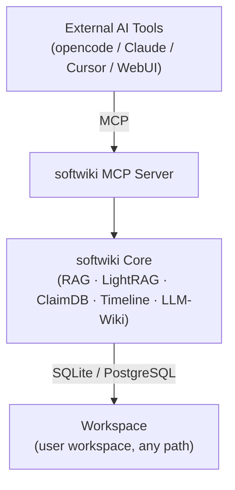

# softwiki documentation

| Category | Description |
|----------|-------------|
| [01-architecture](./01-architecture/overview.md) | System architecture, data flow, interface definitions; [**技术方案选择总表**](./01-architecture/technical-choices.md) |
| [02-design](./02-design/data-model.md) | [**数据模型与表结构（字段/用例）**](./02-design/data-model.md), pipeline, RAG/graph design, config schema; [knowledge-system philosophy](./02-design/knowledge-system-philosophy.md); [graph × claim × wiki retrieval](./02-design/graph-claim-wiki.md); [chat UX](./02-design/chat-ux.md); [multi-kb](./02-design/multi-kb.md); [wiki page granularity](./02-design/wiki-page-granularity.md); [auth/OIDC/超级用户](./02-design/auth-oidc.md) |
| [03-operations](./03-operations/setup.md) | Setup, CLI, storage operations; [user-system manual](./03-operations/user-system-manual.md) |
| [04-guides](./04-guides/quickstart.md) | Quickstart, Shell/WebUI usage, workflows; [Wikiweb 门户](./04-guides/wikiweb.md) |
| [05-roadmap](./05-roadmap/status.md) | Project status, phase planning; [agent-web plan](./05-roadmap/agent-web-plan.md) |
| [06-archive](./06-archive/work-log.md) | Historical decisions, archived design discussions |

---

## 当前状态 / 交接 ★

> 给「下一个 session」看的快照。保持更新。

- **当前阶段**：试用就绪（Trial Readiness）—— 单校、单实例、自部署、试用评估。
- **技术选择总表（2026-11-25）**：[`01-architecture/technical-choices.md`](./01-architecture/technical-choices.md)——各层选了什么 / 为什么 / 没选什么 / 已知欠账。
- **当前知识库**：build-host `kb-alpha`（ARM 技术文档，73 篇 / 39,870 chunks）；trial-host 试用库 `coffee-kb` 185 篇 / 3,489 chunks、`ai-history-kb` 160 篇 / 5,497 chunks。
- **trial-host 语料管线（2026-11-03）**：开发机抓正文 → markdown(front matter) → 推送入库；见 [`03-operations/deployment-trial.md`](./03-operations/deployment-trial.md)。trial-host 对 Wikipedia/Guardian/NewYorker/Atlantic 是 TCP 层封锁，改 DNS 无效。
- **SWAgent（2026-10-24）**：WebUI **Quick / SWAgent** 双模式；opencode engine `1.19.5` `:6111`（宿主 systemd `softwiki-agent-web`）+ API `:6200/api/swa/*`；模型 `gpt-4.1-mini`；acceptance **11/11**。
- **Demo 流程**：[`04-guides/demo.md`](./04-guides/demo.md)（Quick / Agent / Workflow / Report / 验收）。
- **Demo 计划（销售）**：[`04-guides/demo-plan.md`](./04-guides/demo-plan.md)（15/30 分钟脚本、失败预案）。
- **销售培训**：[`04-guides/sales-training.md`](./04-guides/sales-training.md)（话术、异议、边界）。
- **Wiki Prompt Studio**：[`04-guides/wiki-prompt-studio.md`](./04-guides/wiki-prompt-studio.md)（提示词干预 / Preview / Apply / 范例）。
- **进度台账**：[`../progress.md`](../progress.md)（推进的唯一基准）
- **试用清单**：[`05-roadmap/trial-readiness.md`](./05-roadmap/trial-readiness.md)（10 步验收 + P0/P1 任务）
- **长期路线**：[`05-roadmap/status.md`](./05-roadmap/status.md)
- **工作方式**：[`../AGENTS.md`](../AGENTS.md)（会话一次性、文档持久、小步提交）
- **本轮报告**：[`06-archive/session-report-2026-10-23.md`](./06-archive/session-report-2026-10-23.md)
- **Agent Web 计划**：[`05-roadmap/agent-web-plan.md`](./05-roadmap/agent-web-plan.md)
- **知识系统思想**：[`02-design/knowledge-system-philosophy.md`](./02-design/knowledge-system-philosophy.md)
- **知识系统实现计划**：[`05-roadmap/knowledge-system-plan.md`](./05-roadmap/knowledge-system-plan.md)
- **Chat UX 设计（参考 opencoco）**：[`02-design/chat-ux.md`](./02-design/chat-ux.md)（🚧 待评审；只借鉴其会话式 chat，业务流沿用现有实现）
- **多 KB（v0 已部署 trial-host，2026-11-20）**：[`02-design/multi-kb.md`](./02-design/multi-kb.md)——一个 MCP 服务全部知识库；`ask`/`search` 带 `kb`，`kb_list`/`kb_describe` 供 agent 路由；`/api/kb`（`?verify=true` 探测本实例可用性）；auth 关闭时 `/api/workspace` 返回 403；engine 按库缓存。两栈共用 workspace 根但各有 PostgreSQL，故只能服务本栈建过库的那些。
- **LLM-Wiki 页面粒度（2026-11-20）**：[`02-design/wiki-page-granularity.md`](./02-design/wiki-page-granularity.md)——一实体一页，固定 25 条上限，超限拆页不静默截断；`/api/wiki/pages*`；WebUI **LLM Wiki** 面板（搜索 / 类型筛选 / 分页 / `covered/total` 徽章）。
- **Graph × Claim × Wiki 联合检索（2026-11-24，P0）**：[`02-design/graph-claim-wiki.md`](./02-design/graph-claim-wiki.md)——Graph 负责实体链接与 1–2 跳路由，Claim 提供可引用事实，Wiki 提供非 stale 的叙事；`softwiki/intelligence/graph_claim.py` + `tests/test_graph_claim.py`。**尚未部署**。
- **用户系统手册（三种模式）**：[`03-operations/user-system-manual.md`](./03-operations/user-system-manual.md)——单机版 / 用户版 / demo 用户版，安装方式相同，只差 `SOFTWIKI_AUTH_MODE`
- **身份接入 / 权限（✅ 已实现 2026-11-19）**：[`02-design/auth-oidc.md`](./02-design/auth-oidc.md)——不做用户系统，只做「可接入」；外部身份 `(issuer, subject)` → 本地用户表 → 组映射 → 角色 + `kb_scope`；超级用户默认关闭、仅本机；卸载库=脱钩；审计日志；降级工作模式。
- **Knowledge v2 v0（2026-10-30）**：9,766 canonical claims / 10,573 evidence；Conflicts API/UI；Adjudication；AnswerEngine 冲突感知；12 页 Wiki 已用 canonical claims 重建（stale 0）；Graph 6,994/7,211、Timeline 599/639 挂 claim；Wiki rebuild worker + artifact history；structured claim + NLI judge（1 个真实冲突，2 claims disputed）；conflict filters/evidence；MMR；citation check；备份 `/tmp/kb_alpha_before_knowledge_v2.sql`。
- **Session / 沙盒 / 审核计划**：[`05-roadmap/agent-session-sandbox-plan.md`](./05-roadmap/agent-session-sandbox-plan.md)
- **已知限制**：出站 LLM/embedding 许可未确认；OCR 未做；TLS/反代未做；Agent remote MCP 仍暴露写工具（靠 opencode permission）；L2 非流式；部分 PDF 标题为 `Untitled Document`。
