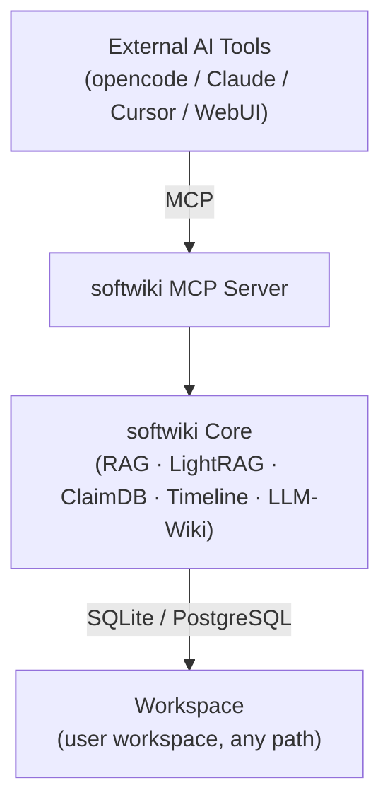

# softwiki documentation

| Category | Description |
|----------|-------------|
| [01-architecture](./01-architecture/overview.md) | System architecture, data flow, interface definitions |
| [02-design](./02-design/data-model.md) | Data models, pipeline, RAG/graph design, config schema; [knowledge-system philosophy](./02-design/knowledge-system-philosophy.md) |
| [03-operations](./03-operations/setup.md) | Setup, CLI, storage operations |
| [04-guides](./04-guides/quickstart.md) | Quickstart, Shell/WebUI usage, workflows |
| [05-roadmap](./05-roadmap/status.md) | Project status, phase planning; [agent-web plan](./05-roadmap/agent-web-plan.md) |
| [06-archive](./06-archive/work-log.md) | Historical decisions, archived design discussions |

---

## 当前状态 / 交接 ★

> 给「下一个 session」看的快照。保持更新。

- **当前阶段**：试用就绪（Trial Readiness）—— 单校、单实例、自部署、试用评估。
- **当前知识库**：`armkb`（ARM 技术文档，73 篇 / 39,870 chunks；全量索引完成）。
- **Agent Web（2026-10-24）**：WebUI **Quick / Agent** 双模式；opencode `:6111`（宿主 systemd `softwiki-agent-web`）+ API `:6200/api/agent/*`；模型 `gpt-4.1-mini`；acceptance **11/11**。
- **Demo 流程**：[`04-guides/demo.md`](./04-guides/demo.md)（Quick / Agent / Workflow / Report / 验收）。
- **Wiki Prompt Studio**：[`04-guides/wiki-prompt-studio.md`](./04-guides/wiki-prompt-studio.md)（提示词干预 / Preview / Apply / 范例）。
- **进度台账**：[`../progress.md`](../progress.md)（推进的唯一基准）
- **试用清单**：[`05-roadmap/trial-readiness.md`](./05-roadmap/trial-readiness.md)（10 步验收 + P0/P1 任务）
- **长期路线**：[`05-roadmap/status.md`](./05-roadmap/status.md)
- **工作方式**：[`../AGENTS.md`](../AGENTS.md)（会话一次性、文档持久、小步提交）
- **本轮报告**：[`06-archive/session-report-2026-10-23.md`](./06-archive/session-report-2026-10-23.md)
- **Agent Web 计划**：[`05-roadmap/agent-web-plan.md`](./05-roadmap/agent-web-plan.md)
- **知识系统思想**：[`02-design/knowledge-system-philosophy.md`](./02-design/knowledge-system-philosophy.md)
- **知识系统实现计划**：[`05-roadmap/knowledge-system-plan.md`](./05-roadmap/knowledge-system-plan.md)
- **Knowledge v2 v0（2026-10-30）**：9,766 canonical claims / 10,573 evidence；Conflicts API/UI；Adjudication；AnswerEngine 冲突感知；12 页 Wiki 已用 canonical claims 重建（stale 0）；Graph 6,994/7,211、Timeline 599/639 挂 claim；Wiki rebuild worker + artifact history；structured claim + NLI judge（1 个真实冲突，2 claims disputed）；备份 `/tmp/armkb_before_knowledge_v2.sql`。
- **Session / 沙盒 / 审核计划**：[`05-roadmap/agent-session-sandbox-plan.md`](./05-roadmap/agent-session-sandbox-plan.md)
- **已知限制**：出站 LLM/embedding 许可未确认；OCR 未做；TLS/反代未做；Agent remote MCP 仍暴露写工具（靠 opencode permission）；L2 非流式；部分 PDF 标题为 `Untitled Document`。
