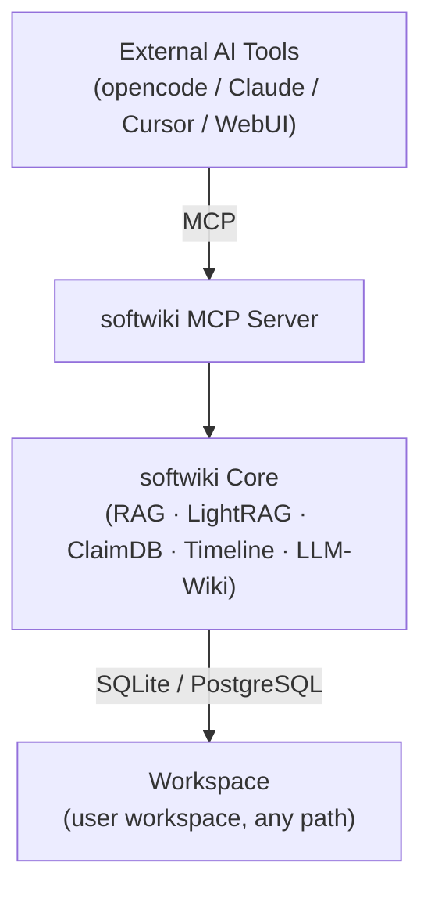

# softwiki documentation

| Category | Description |
|----------|-------------|
| [01-architecture](./01-architecture/overview.md) | System architecture, data flow, interface definitions |
| [02-design](./02-design/data-model.md) | Data models, pipeline, RAG/graph design, config schema |
| [03-operations](./03-operations/setup.md) | Setup, CLI, storage operations |
| [04-guides](./04-guides/quickstart.md) | Quickstart, Shell/WebUI usage, workflows |
| [05-roadmap](./05-roadmap/status.md) | Project status, phase planning |
| [06-archive](./06-archive/work-log.md) | Historical decisions, archived design discussions |

---

## 当前状态 / 交接 ★

> 给「下一个 session」看的快照。保持更新。

- **当前阶段**：试用就绪（Trial Readiness）—— 单校、单实例、自部署、试用评估。
- **进度台账**：[`../progress.md`](../progress.md)（推进的唯一基准）
- **试用清单**：[`05-roadmap/trial-readiness.md`](./05-roadmap/trial-readiness.md)（10 步验收 + P0/P1 任务）
- **长期路线**：[`05-roadmap/status.md`](./05-roadmap/status.md)
- **工作方式**：[`../AGENTS.md`](../AGENTS.md)（会话一次性、文档持久、小步提交）
- **已知阻塞**：20 篇真实 PDF、出站 LLM 许可、测试基线（pytest 挂起）、Postgres/SQLite、OCR 范围。
